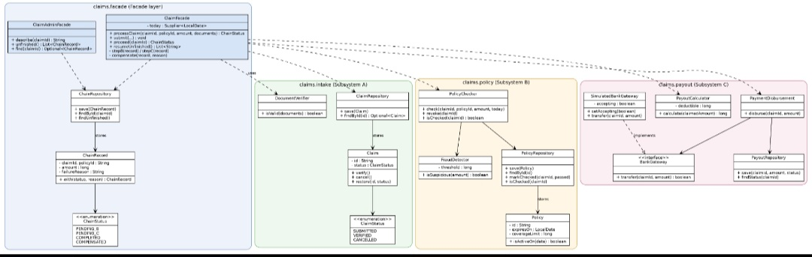

# Insurance Claims: Facade Pattern (SDP Assignment 4, Topic 17)

Student: Ingkar Tolegen
Group: SE-2540

A claim goes through three independent subsystems. A **facade** runs them as one logical operation, stores the state of the chain in a database, and undoes completed steps if a later step fails.

## Build and run

Requirements: Java 17 or newer, Maven.

```
mvn test
mvn compile exec:java "-Dexec.mainClass=claims.app.Main"
```

`mvn test` runs all tests and writes the coverage report to `target/site/jacoco/index.html`.
The application is a console menu. State is stored in `claims.db` (SQLite) in the project root, so it survives a restart.

Menu:

| Option | What it does |
|---|---|
| 1 | Process a claim: A, then B, then C |
| 2 | Run only step A and stop (simulates a crash) |
| 3 | Switch the simulated bank between accepting and declining |
| 4 | Show the status of a claim |
| 5 | List unfinished chains |
| 6 | Resume unfinished chains (also done automatically on start) |

## Architecture

Three subsystems, each with its own business logic, its own state and its own repository:

| Subsystem | Package | Classes |
|---|---|---|
| A: Intake | `claims.intake` | `Claim`, `ClaimStatus`, `DocumentVerifier`, `ClaimRepository` |
| B: Policy check | `claims.policy` | `Policy`, `PolicyChecker`, `FraudDetector`, `PolicyRepository` |
| C: Payout | `claims.payout` | `PayoutCalculator`, `PaymentDisbursement`, `PayoutRepository`, `BankGateway`, `SimulatedBankGateway` |

Two facades in `claims.facade`:

- `ClaimFacade` runs A, B, C, writes the chain status after every step, compensates on failure and resumes unfinished chains.
- `ClaimAdminFacade` is a read-only view of chains for operators (`describe`, `unfinished`, `find`).

Chain status is stored in the `chains` table by `ChainRepository`: `PENDING_B` -> `PENDING_C` -> `COMPLETED` or `COMPENSATED`.

## UML class diagram



## Failure handling

**B fails after A committed** (policy expired, not found, coverage exceeded, fraud suspected).
Step A is already stored. The facade cancels the claim (`CANCELLED`) and marks the chain `COMPENSATED` with the reason. Nothing is paid.

**C fails after A and B committed** (bank declines).
The facade undoes B (the policy check flag is cleared), then undoes A (claim `CANCELLED`) and marks the chain `COMPENSATED`.

**Restart in the middle of a chain.**
After step A the chain is saved as `PENDING_B`. On start, `resumeUnfinished()` reads unfinished chains from the database and continues each one from its stored status. The facade keeps nothing in memory between runs.

**No double payout.**
`PaymentDisbursement.disburse` returns early if the claim is already `PAID`. If the app crashes after the bank transfer but before `COMPLETED` is written, resuming does not pay again.

## Principle of Least Knowledge

**Before** (no facade). The client talks to all three subsystems and knows how they fit together:

```java
Claim claim = new Claim(id);
claim.verify();
claimRepository.save(claim);
policyChecker.check(id, policyId, amount, today);
long payout = calculator.calculate(amount);
disbursement.disburse(id, payout);
// plus manual rollback if something fails
```

The client depends on about ten classes, must know the order of steps and must write the rollback itself.

**After** (with facade). The client talks to one object:

```java
ChainStatus result = facade.processClaim(id, policyId, amount, documents);
```

The client knows only `ClaimFacade` and `ChainStatus`. The facade talks only to its own fields (the subsystems it was given) and does not reach through them with chains like `claims.findById(id).get().getStatus().name()`.
The subsystems do not import the facade or each other. `ArchitectureTest` checks this automatically by scanning the imports.

## Facade vs Adapter

Both are structural patterns, but they solve different problems.

- **Facade** gives a new, simpler interface over several classes. `ClaimFacade` hides three subsystems (A, B, C) behind `processClaim`. Its purpose is to reduce what the client has to know and to coordinate several objects. The subsystems keep their own interfaces and could still be used directly.
- **Adapter** makes one existing interface fit another interface the client expects. In this project the closest example is `BankGateway`: the payout code expects `transfer(claimId, amount)`, and `SimulatedBankGateway` provides it. A real bank client with a different API would be wrapped the same way. It converts one interface into another and does not coordinate anything.

Short rule: a facade simplifies many classes for the client, an adapter translates one class to a different interface.

## Testing

- JUnit 5, tests follow F.I.R.S.T.: every test uses its own temporary database (`@TempDir`) and a fixed date, so tests are fast, independent and repeatable.
- Persistence is checked by reopening the database with a new repository object, so data is read from the file and not from memory.
- Custom test DSL: `claims.testsupport.Scenario` (`newFacade()`, `bankDeclines()`, `assertChainIs(...)`, `assertClaimIs(...)`, `assertPayoutIs(...)`). Tests read like sentences about claims.
- `ArchitectureTest` checks the dependency rules between packages.

## Coverage

Tool: JaCoCo (`jacoco-maven-plugin`). Report: `target/site/jacoco/index.html`.

| Package | Line coverage |
|---|---|
| `claims.intake` | 95% |
| `claims.policy` | 89% |
| `claims.payout` | 88% |
| `claims.facade` | 93% |

The requirement is at least 80% line coverage for the three subsystems and the facades. The console menu `claims.app.Main` is not counted: it only reads input and prints output, and all logic it calls is covered by the facade tests.

## Git history

Tests are committed together with the code they test, one subsystem per commit.